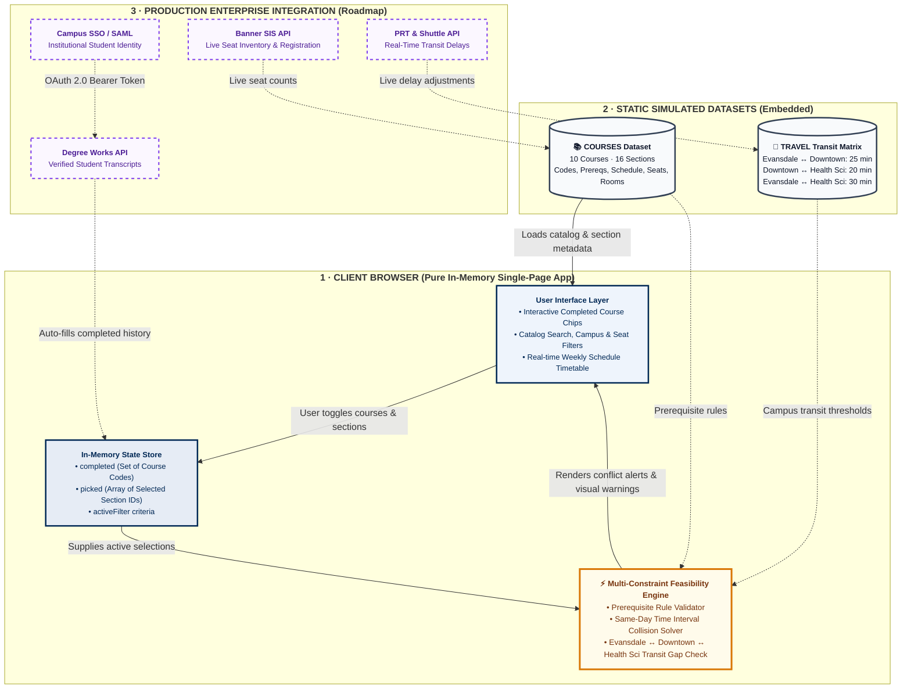

# Architecture Document: Smart Class Registration
**Event:** WVU Bobathon Reference Build  
**Pattern:** Ephemeral Client-Side Reactive Single-Page Application (Zero-Footprint Prototype)  
**Branding & Standards:** WVU Blue (`#002855`), Old Gold (`#EAAA00`), WCAG 2.1 AA Accessibility  

---

## 1. Executive Summary & Solution Concept

The **Smart Class Registration** prototype demonstrates how client-side intelligence can instantly validate student course registration against three simultaneous constraint vectors:
1. **Academic Prerequisites:** Validates chosen course prerequisites against in-memory student completion records.
2. **Time Overlaps:** Detects same-day time collisions between selected sections across weekly time blocks.
3. **Inter-Campus Transit Feasibility:** Computes transit time buffers between physical campuses (Evansdale, Downtown, Health Sciences) and alerts students if the interval between consecutive classes is shorter than transit requirements.

---

## 2. High-Contrast System Architecture Diagram

---

## 3. Component Details & Data Flow

| Layer | Component | Implementation | Responsibility |
|---|---|---|---|
| **Presentation** | UI Controls & DOM | Vanilla JS + semantic HTML5 | Responsive course catalog, live filter triggers, completed course chips, and weekly visual timetable. |
| **State** | Reactive In-Memory Store | `Set` & `Array` in JavaScript closure | Ephemeral storage of selected section IDs and completed course prerequisites. |
| **Logic** | Feasibility Solver | `feasibility(secs)` function | Iterates pairwise across scheduled days, calculates time deltas ($gap = start_2 - end_1$), and verifies against transit matrix ($gap \ge need$). |
| **Data** | Static Synthetic Datasets | `COURSES` & `TRAVEL` objects | Fictional WVU catalog data with section times, seats, rooms, prerequisites, and inter-campus transit matrix. |
| **Enterprise (Future)** | Student Information System | REST API / GraphQL | Live Banner SIS seat counts, Degree Works transcript validation, and PRT transit alerts. |

---

## 4. Security, Privacy & Non-Functional Requirements (FERPA Compliance)

- **Zero Persistence:** No student selections are stored in `localStorage`, cookies, or remote databases.
- **Client-Side Execution:** The application executes 100% inside the client sandbox with no external tracking or telemetry.
- **Synthetic Data Guarantee:** Fictional student courses and simulated schedules eliminate all risk of exposing confidential academic or personal records.
- **Accessibility:** Fully accessible via keyboard navigation, high-contrast focus rings (`#EAAA00`), and semantic ARIA live regions for screen readers.
